# MediLens MVP 2.0 设计记录（项目可运行）

> 状态：**MVP 2.0 核心链路已实现并在 Android 模拟器上端到端测试通过**（2026-10-24）。需求基线见 `docs/MediLens_MVP1_跨模型开发交接说明.md`，冲突时以交接说明为准（本版不做虚拟宠物）。
> 本文件供小组文档使用；开发过程记录见 `docs/开发进展.md`。

## 1. 本轮目标

达到课程 MVP V2.0「项目可运行」，对应交接说明阶段 1，端到端跑通：

游客模式 → 拍照/相册导入 → 本地 OCR → 低置信字段原图高亮+候选确认 → 规则引擎（模拟规则，界面标注「测试规则，未经医学审核」）→ 解读总览 → 动态选择题（可跳过/回退）→ 逐条「详细了解」→ 文字对话 → 本地保存/不保存 → 普通/老年模式都可完成。

实时语音打断、药盒识别、注册与云备份、趋势、提醒等已确认功能：本轮保留页面入口、数据结构和接口，标注「待实现」，不删除、不改变产品定义。

## 2. 需求覆盖矩阵

| 需求 | 页面 | 后端模块 | 自动化测试 | 本轮 |
|---|---|---|---|---|
| 游客模式，不强制注册 | P01 | — | widget：游客入口可直达主页 | 实现 |
| 拍照/相册/文件（图片、PDF 白名单）、旋转、重拍、模糊提示 | P02 | — | 白名单与模糊检测单测 | 实现（PDF 逐页渲染为图） |
| 本地 OCR，原图不离端 | P02→P03 | — | OCR 后处理单测、合成图集成测试 | 实现（PP-OCRv5 + ONNX Runtime） |
| 低置信/矛盾字段原图坐标高亮、放大、候选、第 x/y 项、无法确认、重拍 | P03 | — | 坐标映射（含旋转）单测、unknown 状态单测 | 实现 |
| 同义词映射、定性分级、UACR 单位换算 | — | normalize | pytest 参数化 | 实现 |
| 规则引擎（YAML 版本化，R-01～R-06 模拟规则），unknown 不参与确定性规则 | P04 | rules | pytest：命中/不命中/缺失 | 实现，全部标注测试规则 |
| 解读总览：高风险置顶、未知不变绿、数据完整性 | P04 | analysis | API + widget | 实现 |
| 动态选择题（YAML，可跳过/回退，未答≠否认） | P05 | followup | pytest 跳转、widget 回退 | 实现 |
| 逐条「详细了解」、朗读 | P06 | explain | widget：只展开该条 | 实现（朗读用系统 TTS） |
| 文字对话、越界问题安全模板、输出校验 | P06 | chat + llm adapter + guard | pytest：数值一致、禁用语、来源 | 实现；已接入学校多模型平台（DeepSeek-V4.1-Flash），未配置时为 mock |
| RAG 框架（占位测试知识，不伪造指南） | P06 | knowledge | pytest：检索不到时明确说明 | 框架 + 占位知识 |
| 本机保存/不保存并明示风险 | 保存选择 | — | 本地存储单测 | 实现（加密 SQLite） |
| 普通/老年模式全流程 | 全部 | — | 两模式各跑集成测试 | 实现 |
| 实时语音与打断 | P07 | voice adapter 接口 | 契约测试 | 待实现（入口+状态机+接口） |
| 药盒识别 | P08 | medication 接口 | 契约测试 | 待实现 |
| 注册、云 OCR、云备份 | P01/P11 | auth、ocr_cloud、backup 接口 | 契约测试 | 待实现（数据结构与同意记录先建） |
| 历史与趋势 | P09 | — | 列表/删除单测 | 列表+删除实现，趋势待实现 |
| 复诊问题、提醒 | P10 | — | — | 复诊问题实现，提醒待实现（仅本地通知，不用 FCM） |
| 设置中心 | P11 | — | widget | 显示/OCR/语音/数据实现，其余标待实现 |

## 3. 技术架构

```
Flutter APP（Android/iOS 一套代码）
 ├ 导入：image_picker / file_picker / pdfx（PDF 渲染为图）
 ├ 本地 OCR：PP-OCRv5 mobile det+rec（ONNX，约 21MB，随 APP 打包）+ onnxruntime；
 │           DB 后处理与 CTC 解码用 Dart 实现
 ├ 坐标：统一使用「旋转/裁剪后图像」的归一化坐标，高亮框与 OCR 结果同一坐标系
 ├ 本地存储：SQLCipher 加密 SQLite，密钥存 flutter_secure_storage
 ├ 状态管理 Riverpod，路由 go_router
 └ 仅上传：脱敏结构化指标 + 问答答案（游客绝不上传原图）
                     │ HTTPS/JSON
FastAPI 后端（Python 3.11）
 ├ normalize → rules(YAML) → followup(YAML) → knowledge(检索) → llm adapter → guard 校验
 ├ llm adapter：mock / compat（学校等 OpenAI 兼容聚合平台）/ deepseek / qwen / zhipu；密钥只在 .env；关闭推理、超时回退
 ├ voice / cloud_ocr / auth / backup：接口 + mock（讯飞/阿里/百度/腾讯后续接入）
 └ 存储：开发 SQLite；docker-compose 中 PostgreSQL
```

### 选型理由
- **Flutter**：交接说明建议方案，一套代码双端；Android 不依赖 Google Play 服务。
- **PP-OCRv5 ONNX**：项目书指定 PaddleOCR 路线；国产模型，端侧运行不联网；ONNX Runtime 官方支持 Android/iOS。
- **FastAPI**：项目书规定规则引擎用 Python 实现。
- **大模型**：DeepSeek、通义提供 OpenAI 兼容协议、国内域名（api.deepseek.com / dashscope.aliyuncs.com），用 httpx 直连，不引入 openai SDK、不访问 OpenAI。
- **字体与静态资源**：系统字体或本地打包，不使用 google_fonts，不使用境外 CDN。
- **网络合规**：开发完成后输出外部请求清单，并加入扫描境外域名的检查脚本。

## 4. 页面地图

```
P01 启动/隐私说明 ─┬ 游客体验 → 主页（大按钮「拍照解读」；相册、文件、历史、语音[待实现]、设置）
                   └ 注册/登录[待实现]
主页 → P02 导入/预览（旋转·重拍·质量提示）→ 本地 OCR 进度
   → P03 局部确认（原图高亮框+放大+候选，第 x/y 项）→ 非目标报告提示页
   → P04 总览（测试规则标识、高风险置顶、未知项）
   → P05 动态选择题（跳过/上一题）→ P04 更新后总览
   → P06 逐条解释（详细了解·朗读·快捷问题·文字对话）
   → 保存选择（本机加密保存/不保存）→ P09 历史 / P10 复诊问题
P07 语音[待实现] · P08 药盒[待实现] · P11 设置（普通/老年、OCR、语音、数据删除、医疗边界）
```

## 5. 关键设计决策

| 决策 | 内容 | 理由 |
|---|---|---|
| 后端启动方式 | 本地以 `python scripts/run_backend.py` 一条命令启动；同时提供 docker-compose.yml | 开发机未安装 Docker/WSL；Compose 在实测前标注「未经实测」 |
| 运行设备 | Android 模拟器（开启 Windows 虚拟机监控程序平台） | 小组暂无 Android 真机；BIOS 虚拟化已开启 |
| iOS | 代码与工程配置保持通用，不做实机编译验证 | 无 Mac 环境 |
| 大模型 | 接入学校多模型平台（compat），模型 DeepSeek-V4.1-Flash，关闭推理（thinking=disabled），超时 15 秒回退标准说明 | 只做改写：开启推理时 15–20 秒，关闭后 2–7 秒；未配置时自动 mock |
| 大模型的使用范围 | 仅提问页回答的通俗改写；判读、选择题、详细了解、越界安全模板均不经过大模型 | 规则定结论、大模型只表达，便于审核 |
| 知识库不足时 | 检索不到资料即回答「暂时没有可核验的资料」，不交给大模型 | 避免无依据的医学内容；知识库扩充见 docs/知识库资料调研.md |
| 测试数据 | 脚本生成合成报告图，图上带「合成测试样本」水印 | 不使用真实报告 |
| 规则 | R-01～R-06 作为模拟规则，界面与 API 均标注「测试规则，未经医学审核」 | 尚未医学审核 |
| 项目书 docx | 不提交到公开仓库 | 可能含个人信息 |

## 6. 实现后的关键设计（开发中确定）

### 6.1 端到端数据流

```
拍照/相册/文件 ──► 质量检查（清晰度/亮度/反光/分辨率）──► 用户可旋转/重拍
   │（原图只在本机内存）
   ▼
本地 OCR：PP-OCRv5 检测 → 连通域成框 → 横置自动判断旋转 → 识别（CTC）
   ▼
报告解析：按行聚类 → 定位表头列 → 拆分合并单元格 → 同义词映射 → 日期
   ▼
复核判断：置信度 < 0.85 / 写法不合法 / 单独的「+」/ 单位缺失或无法识别 / 数值超合理范围 / 阴性带↑ / 未识别结果 → 局部确认
   ▼
P03 局部确认：原图高亮框（与 OCR 同一坐标系）+ 局部放大 + 候选 / 其他 / 无法确认 / 重拍
   ▼
首次解读前单独告知并同意（只发送结构化指标，不含图片、姓名、医院）
   ▼
后端：标准化（换算/参考范围/矛盾）→ 规则引擎（三值逻辑）→ 总览 → 下一题
   ▼
P04 总览 ⇄ P05 选择题（服务端无状态，每次提交全部回答，回退=删除最近回答后重算）
   ▼
P06 详细了解（规则+占位知识，确定性生成）/ 对话（安全分类 → 草稿 → 大模型改写 → 输出校验 → 失败回退）
   ▼
保存选择：本机 SQLCipher 加密保存（不含原图）或不保存（清空内存会话）
```

### 6.2 关键决策（实现阶段）

| 决策 | 内容 | 理由 |
|---|---|---|
| 规则三值逻辑 | 条件结果为 成立/不成立/信息缺失；缺失时列入「无法判断，不代表正常」 | 交接说明：不可把未知解释成正常 |
| 未知不变绿 | 无命中规则但有无法确认项、缺关键项或未覆盖异常 → 总体「部分信息无法判断」（灰） | 同上 |
| 紧急提示不等待 | 命中紧急规则或选择题报告危险症状 → 总览顶部红色卡片，问卷页也置顶显示 | 先安全后解释 |
| 选择题服务端无状态 | 客户端提交全部回答；「上一题」=撤销最近回答再判读 | 回退简单可靠，回答改变时解释自动更新 |
| 「不确定/不愿透露/跳过」 | 特殊回答值，规则视为信息缺失，不视为否定 | 不可假设未回答即无症状 |
| 详细了解确定性生成 | 由规则文本与知识条目组装，不经大模型 | 关键解释可审核、可复现；大模型只用于对话的通俗改写 |
| 大模型只改写草稿 | 草稿由规则/知识组装；模型输出经数值一致性、越界表述、无依据紧急结论校验，不通过则回退草稿 | 规则判读与语言生成分离 |
| 越界问题安全模板 | 停药/换药/剂量（关键词 + 药名×动作词组合）、诊断、危险症状 → 固定安全回复 | 不只靠单一关键词过滤 |
| 复核阈值 0.85 | 依据合成开发集 130 份的错误分析：0.85 以上的错误均已被写法/数值规则拦截；独立测试集结果见 `docs/MVP2_测试结果.md` | 需用真实照片再校准 |
| 候选生成按 OCR 规律 | 「±」误读、丢失的「+」、I/l→1、逗号→小数点、丢失的小数点；英文缩写形近字匹配（PR0→PRO） | 来自开发集错误分析 |
| 开发集/测试集分离 | 调参只用开发集，成绩只报独立测试集 | 避免高估效果 |
| 不依赖「↑」箭头 | 箭头检测不稳定，异常判断只用参考范围比对；箭头仅用于矛盾检测 | 实测结论 |
| 不保存原图 | 本机只保存结构化指标、问答、解读快照、对话 | 原图持久化策略待产品确认，先取最小化 |
| 合成示例入口 | 主页「体验合成示例报告（演示用）」，界面明示虚构数据 | 模拟器无相机素材；便于课堂演示 |
| 模拟器选 AOSP 镜像 | 不含 Google 服务 | 模拟国内手机，验证不依赖 Google |

### 6.3 页面与代码对应

| 页面 | 文件 |
|---|---|
| P01 启动 | `app/lib/features/welcome_page.dart` |
| 主页 | `app/lib/features/home_page.dart` |
| P02 导入预览 | `app/lib/features/import_page.dart` |
| P03 局部确认 | `app/lib/features/review_page.dart` |
| P04 总览 | `app/lib/features/overview_page.dart` |
| P05 选择题 | `app/lib/features/followup_page.dart` |
| P06 详细了解 / 对话 | `app/lib/features/explain_panel.dart`、`chat_page.dart` |
| 保存选择 | `app/lib/features/save_page.dart` |
| P09 历史 / P10 复诊问题 / P11 设置 | `history_page.dart`、`doctor_page.dart`、`settings_page.dart` |
| P07 语音 / P08 药盒 / 注册 / 提醒（待实现） | `app/lib/app.dart` 中的待实现页 |

## 7. 阻塞与风险（截至 2026-10-24）

1. Docker 未安装：Compose 文件未经实测。
2. 仅在 Android 模拟器上测试，未在真机测试。
3. iOS 无法实机编译验证。
4. 无语音/云 OCR 密钥：使用 mock；大模型已接入学校平台（密钥仅在开发电脑 .env）。
5. 合成报告测试通过 ≠ 真实报告识别准确率达标。

## 8. 开发计划与完成情况（每模块：测试 → 中文 commit → push 到 dev）

1. ✅ 仓库骨架：.gitignore、README、.env.example、课程文档初稿
2. ✅ 后端：normalize + rules YAML + followup + 总览 API + pytest
3. ✅ 后端：knowledge 检索 + llm adapter + guard + chat API；语音/药盒/云 OCR/账号待实现接口
4. ✅ 合成报告生成脚本 + fixtures
5. ✅ Flutter 骨架：路由、主题（普通/老年）、P01、主页、P11
6. ✅ 本地 OCR（ONNX）+ P02 导入 + P03 局部确认
7. ✅ P04/P05/P06 + 保存选择 + P09/P10 基础版
8. ✅ 端到端集成测试（双模式）、外部网络请求清单、大陆网络测试方案，更新课程文档

## 9. 界面截图（Android 模拟器实拍，合成数据）

由 `integration_test/screenshots_test.dart` 自动生成。

| 截图 | 说明 |
|---|---|
| 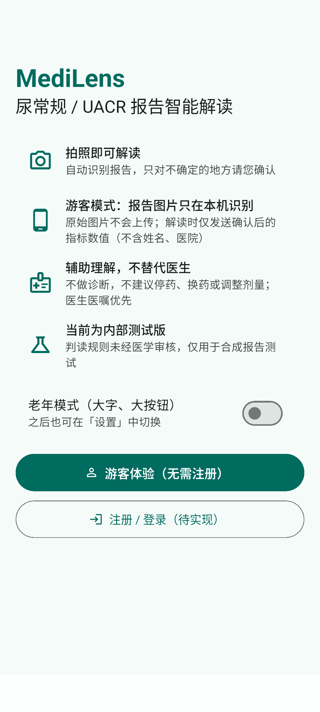 | P01 启动：功能与隐私边界、游客体验、老年模式开关 |
| 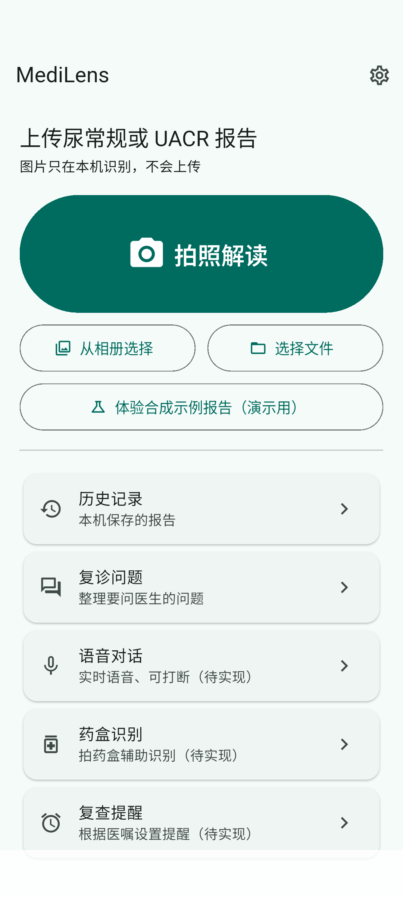 | 主页：拍照解读为主入口 |
| 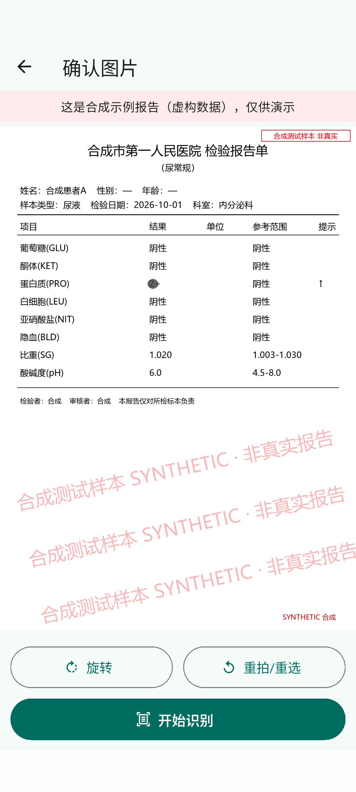 | P02 导入预览：旋转/重拍 |
| 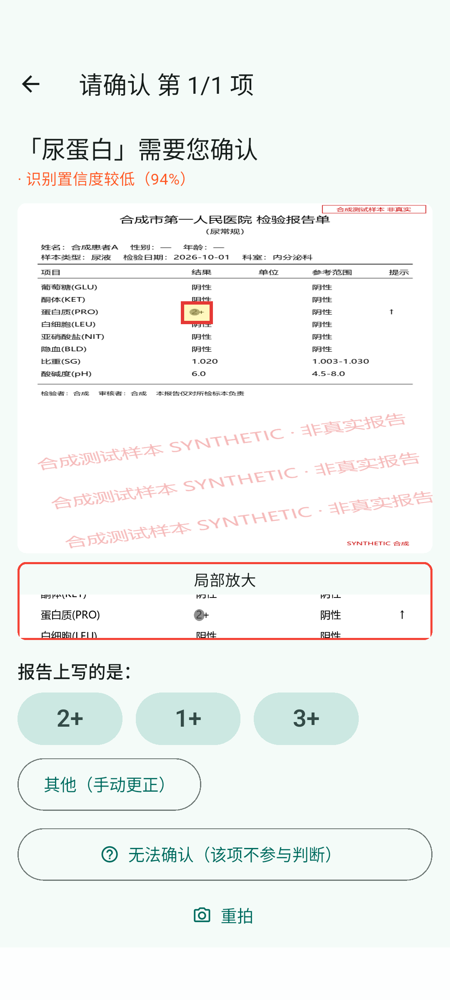 | P03 局部确认：原图高亮框、局部放大、候选、无法确认 |
| 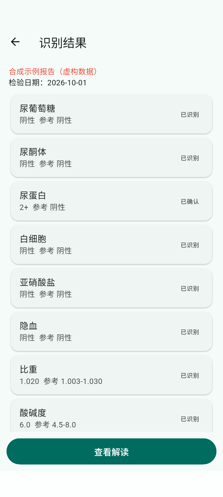 | 识别结果汇总 |
| 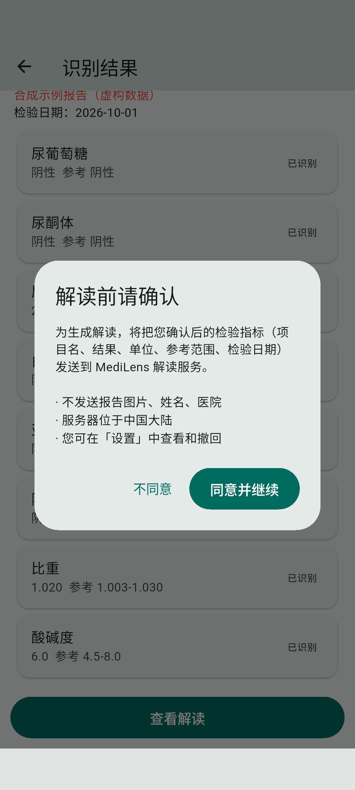 | 首次解读前单独告知并同意 |
| 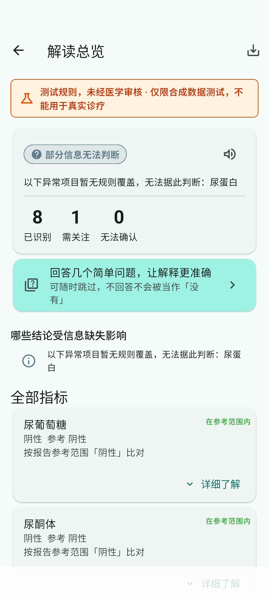 | P04 总览：测试规则标识、未知不变绿 |
| 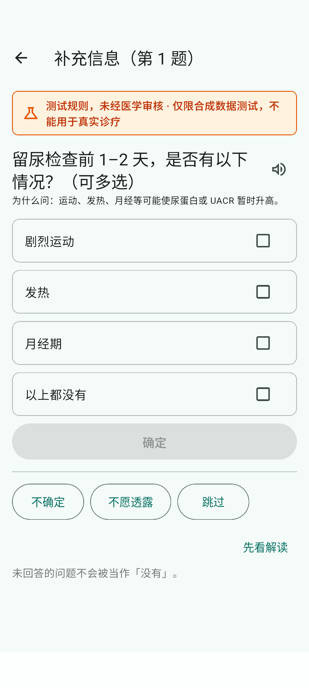 | P05 动态选择题：不确定/不愿透露/跳过/上一题 |
| 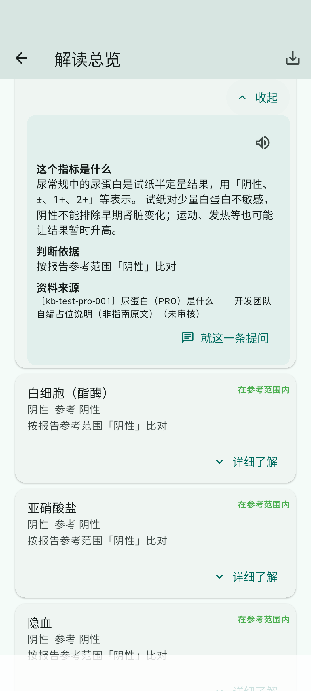 | P06 详细了解原位展开 |
| 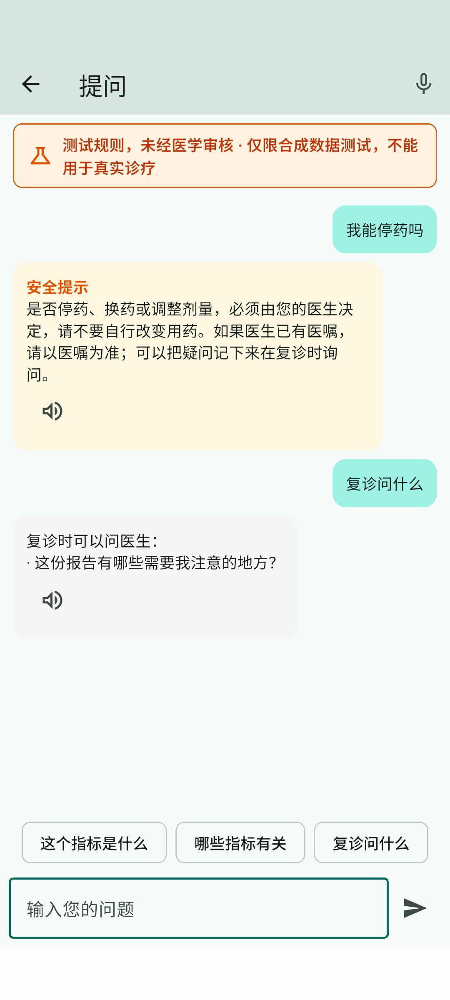 | P06 对话：「停药」走安全模板 |
| 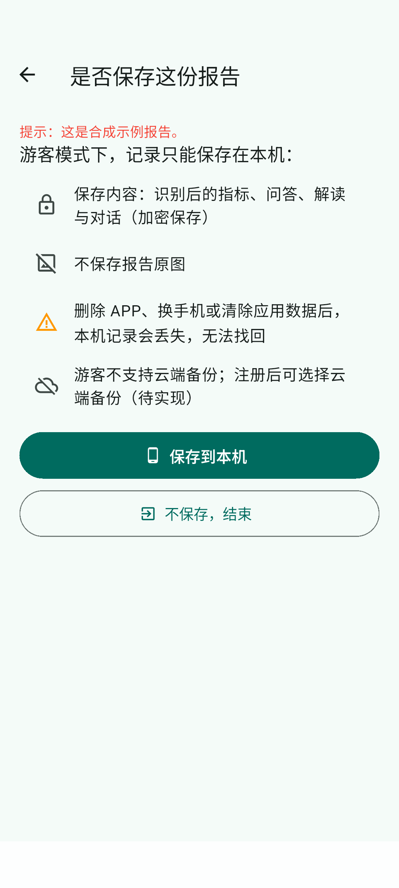 | 保存选择：本机加密/不保存 |
| 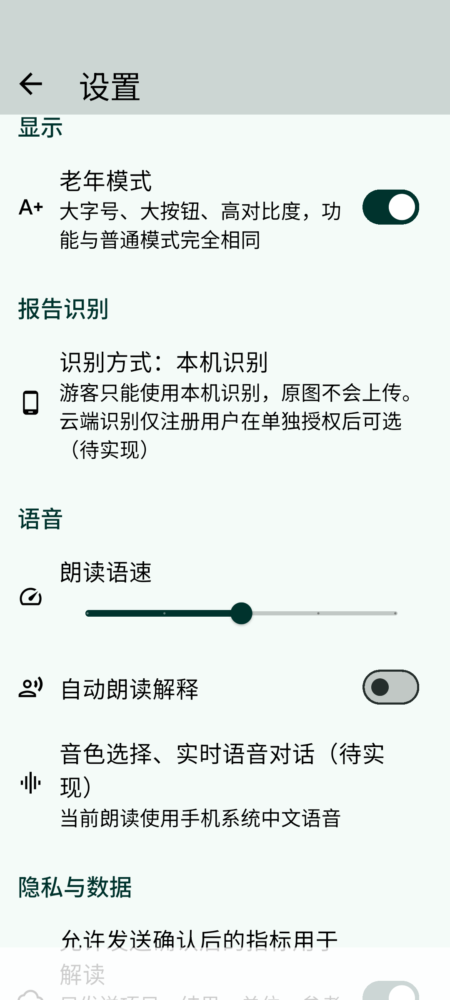 | P11 设置中心（老年模式） |
| 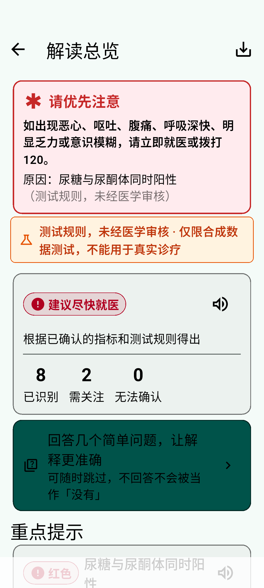 | 老年模式：紧急提示置顶 |
| 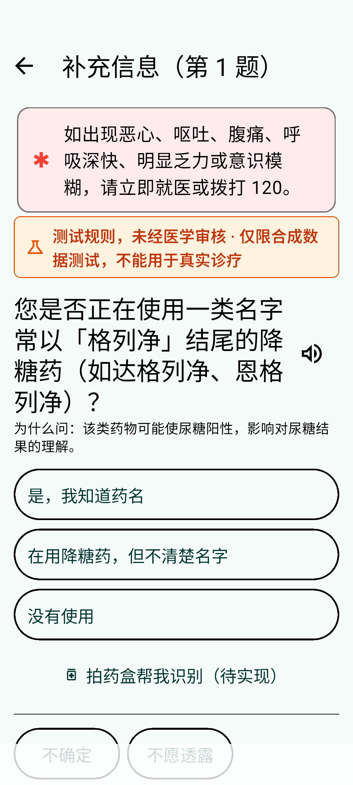 | 老年模式：选择题 |
