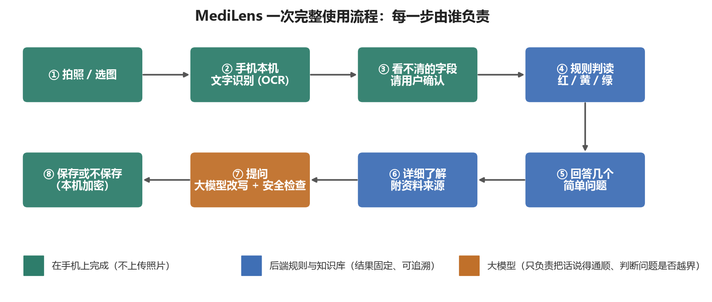
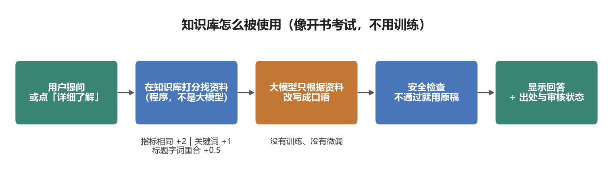
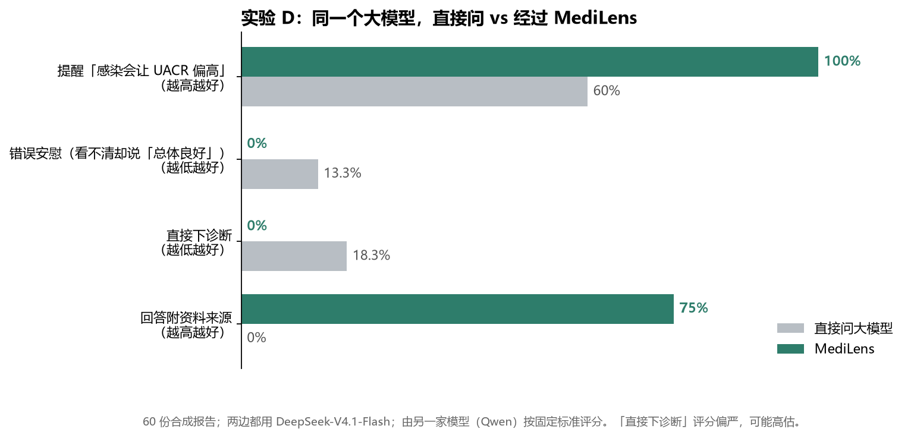
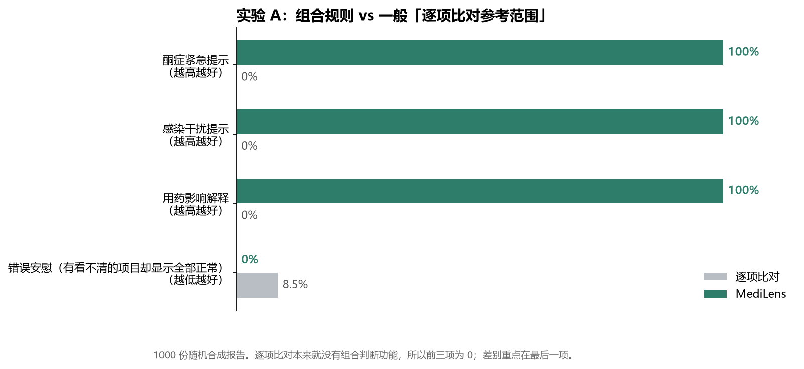
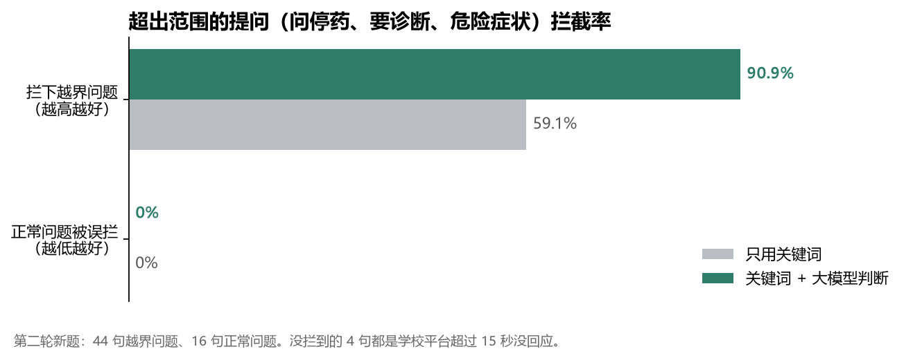
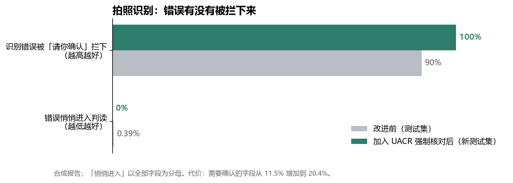

# MediLens 成果与技术说明（组员版）

> 写给所有组员，不需要计算机背景也能看懂。**每次有新进展都会更新**，最新更新记录见文末。
> 所有测试都用**虚构的合成报告**；判读规则是**测试规则，尚未经医学审核**。

---

## 一、MediLens 是什么（一句话）

帮糖尿病患者**看懂尿常规 / UACR 报告**的手机 APP：拍一张报告，APP 告诉你哪些项目需要注意、为什么、复诊该问医生什么——**不下诊断、不建议停药换药**。

---

## 二、现在能做什么

| 功能 | 状态 | 说明 |
|---|---|---|
| 拍照 / 相册导入报告 | ✅ 可用 | 照片只在手机里处理，**不上传** |
| 自动识别报告文字 | ✅ 可用 | 看不清的字段会在原图上框出来，请用户确认 |
| 红 / 黄 / 绿 判读 | ✅ 可用 | 尿糖+酮体同时阳性会**置顶提示就医** |
| 回答几个简单问题 | ✅ 可用 | 如「最近有没有尿路感染症状」「是否在用某类降糖药」，可跳过、可回上一题 |
| 「详细了解」每一条 | ✅ 可用 | 附资料来源（目前多为占位资料，正式资料整理中） |
| 文字提问 | ✅ 可用 | 问停药、要诊断、危险症状会被拦下，改为安全提示 |
| 保存 / 不保存 | ✅ 可用 | 保存在手机里，加密 |
| 老年模式 | ✅ 可用 | 大字、高对比、紧急提示更醒目 |
| 语音、药盒识别、注册与云备份、趋势图、提醒 | ⏳ 待实现 | APP 里有入口，点了会显示「待实现」 |

| 解读总览 | 安全回复 | 老年模式 |
|---|---|---|
|  |  |  |

---

## 三、用到哪些技术（白话版）

| 技术 | 在 MediLens 里做什么 | 打个比方 |
|---|---|---|
| **Flutter** | 做手机 APP 的画面和操作 | APP 的「外壳和按钮」 |
| **OCR（PP-OCRv5，在手机上运行）** | 把报告照片里的字读出来 | 会认字的眼睛，而且不用把照片寄出去 |
| **版面解析 + 置信度** | 判断每个字读得有多确定，不确定就请用户确认 | 读不清时会说「这个字你帮我看一下」 |
| **规则引擎（Python 后端）** | 按写好的规则给出红/黄/绿，例如「尿糖和尿酮同时阳性 → 提示就医」 | 照着检查清单逐条打勾，同样的报告永远得到同样的结果 |
| **知识库 + 检索** | 每条解释都附上出处 | 解释时翻到书的哪一页给你看 |
| **大模型（学校平台 DeepSeek）** | ① 把解释改写得更口语；② 判断提问是否越界 | 文笔好的实习生：负责「说」，不负责「判」 |
| **安全检查** | 检查大模型的回答有没有出现报告里没有的数字、有没有越界 | 实习生写完，主管再核对一遍才发出去 |
| **本机加密存储** | 历史记录加密保存在手机里 | 带锁的抽屉 |

### 大模型放在哪？我们有没有「训练 / 微调」大模型？

**没有训练，也没有微调。** 大模型是现成的（学校平台提供），我们做的是**给它套上规则和检查**：

1. **判读不交给大模型**：红黄绿、要不要提示就医，全部由固定规则决定，可追溯、可重复。
2. **大模型只改写已经核实过的内容**，改写后再检查一次；检查不过就退回原来的稳妥说法。
3. **提问先过安全关**：关键词先拦一次，大模型再从语意上判断一次。
4. **没有大模型也能用**：断网或平台出问题时，APP 照样给出判读和解释，只是语句没那么口语。

### 红黄绿是谁判断的？

**是我们写的规则，由程序执行，不是大模型。** 规则写在 `rules.yaml` 里，例如：

> 如果「尿糖阳性」而且「尿酮体阳性」→ 红色，提示尽快就医

程序逐条比对报告，结果固定：同一份报告永远得到同样的判读，也能说清楚是哪一条规则造成的。看不清的项目一律算「无法确认」，**不会被当成正常**。每条规则都附上文献依据（知识库条目），但规则本身还需医学审核。

### 知识库怎么用？要训练吗？

**不用训练。** 像「开书考试」：

1. 用户点「详细了解」或提问；
2. 程序在知识库里**打分找资料**：指标相同 +2 分、问题里出现条目的关键词 +1 分、问题和条目标题有相同的两字词各 +0.5 分，取分数最高的几条；
3. 把找到的资料交给大模型，请它**只根据这些资料**改写成口语；
4. 改写后检查，再连同出处一起显示。

找资料这一步**不是大模型找的**，是固定的打分方法，好处是结果可解释、不花钱、离线也能用。知识库变大后可以换成「语意检索」（让程序理解同义词），接口不用改。

---

## 四、成果：和其他做法比，MediLens 好在哪里

### 1. 和「直接问大模型」比（实验 D）

同一个大模型、同样 60 份报告：一组直接把报告丢给大模型问，一组经过 MediLens。

- **不是全面碾压**：直接问大模型时，基本安全做得也不错（没编造检查结果、没建议停药、紧急情况都会叫你就医）。
- **MediLens 赢在四件事**：会提醒干扰因素（60% → 100%）、看不清的项目不会被说成「没问题」（13.3% → 0%）、不乱下诊断（18.3% → 0%）、回答有出处（0% → 75%）。
- 这些差别来自**规则、知识库和安全检查**，不是因为我们的模型更聪明——两边用的是同一个模型。

### 2. 和「逐项比对参考范围」比（实验 A，1000 份报告）

一般做法是每一项跟参考范围比，超出就标红。它不会看出「两项一起出现才危险」，而且约每 12 份有看不清项目的报告，就有 1 份会显示「全部正常」。

### 3. 越界提问拦截

加入大模型的语意判断后，从 59% 提高到 91%，正常问题没有被误拦。**仍需改进**：学校平台偶尔超过 15 秒才回应，这时危险症状的提问可能漏拦。

### 4. 拍照识别

UACR 这类关键数值现在一律请用户对照原图确认，读错的数字不会悄悄进入判读。代价是用户要多确认一项左右。

---

## 五、还不够好的地方（如实）

| 问题 | 影响 | 计划 |
|---|---|---|
| 知识库只有 14 条附文献的条目，且未经医学审核 | 部分问题仍会回答「暂无可核验资料」；APP 会标示「未经医学审核」 | 继续补充条目；请医学背景同学审核 |
| 规则未经医学审核 | 不能对外宣称临床正确 | 找医学背景老师或同学审核 |
| 危险症状提问可能因平台超时漏拦 | 安全风险 | 优先处理 |
| 真实照片识别率未测 | 只测过合成报告 | 需要收集已脱敏的真实报告照片 |
| 「看得懂吗」未做真人评分 | 不知道患者觉得好不好懂 | 找人试用打分 |
| 服务器只在校园网内可用 | 校外要连学校 VPN | 已部署到学校 AIOP 平台服务器（见 [服务器部署与启动指南](服务器部署与启动指南.md)） |

---

## 六、知识库现况（组员请看）

- 组员整理的 3 份资料已逐条核查，结果见 [组员资料核查与知识库建议.md](组员资料核查与知识库建议.md)。
- 文献本身都是真的、关键数字也对，但**有 16 处引用写错**（作者、期刊或年份）——AI 生成的资料一定要核对。
- 已据此整理 **14 条知识条目**：[知识库初稿_组员资料核实版.xlsx](知识库初稿_组员资料核实版.xlsx)。**内容全部来自组员资料中引用的文献**，每篇都查过原始摘要（或指南原文）确认说法有依据，再用通俗中文改写。
- **已导入 APP（2026-10-28）**：「详细了解」和提问会显示「出处：作者、期刊、年份 · 未经医学审核」；6 条判读规则也都连上了对应文献。
- 原本 7 条「团队自编占位说明」保留，用来回答「这个指标是什么」，并标明「非指南原文」。
- 继续补充时请用 [知识库填写范本.xlsx](知识库填写范本.xlsx)，填法见 [知识库填写指南.md](知识库填写指南.md)。

---

## 七、名词小词典

| 名词 | 意思 |
|---|---|
| UACR | 尿白蛋白 / 肌酐比，看肾脏有没有早期受影响 |
| OCR | 把图片里的字变成文字 |
| 规则引擎 | 按写好的「如果…就…」规则自动判断 |
| 大模型 | 像 DeepSeek、通义千问这类会写文字的 AI |
| 微调 | 用自己的数据再训练大模型（**我们没有做**） |
| 知识库 | 我们整理好、附出处的医学说明 |
| 后端 | 放在电脑或服务器上、负责判读和回答的程序 |
| 合成报告 | 程序生成的虚构报告，用来大量测试 |

---

## 更新记录

| 日期 | 更新内容 |
|---|---|
| 2026-10-27 | 首版：功能、技术、实验 A/D、拦截与识别成果、组员资料核查与知识库初稿 |
| 2026-10-28 | 知识库 14 条导入 APP 并显示出处；补充「红黄绿是谁判断的」「知识库怎么用」 |
| 2026-10-28 | 后端部署到学校服务器（101.6.162.67），APP 预设连接服务器并加上访问口令 |
